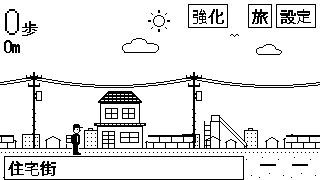

# Playing the game

Walk through Japan, the world, space, history, and fantasy, then return home.
The journey contains 41 regions and 248 sights.
Your steps pay for shoes, companions, and four gates.

## Launch

Unpack the complete package for your operating system.
On Windows, open `Walk.exe`.
On macOS, open `Walk.app`.
On Linux, run `./Walk.x86_64` in the extracted directory.
The packages include the game engine, font, artwork, music, and license notices.

The macOS package has an ad-hoc signature for local use.
Downloaded builds may require approval through [Apple's procedure for opening an app](https://support.apple.com/en-us/102445).

## Walking and upgrades

The left mouse button, Space, and Enter each take one step.
The `歩` counter shows the steps available to spend.
Buying an upgrade keeps your lifetime steps and distance.
The `強化` button opens shoes and companions.
Shoes increase distance per step, and companions add steps each second while the game runs.
The uncovered landscape accepts steps while the shop or journey panel is open.

Each region divides its distance interval among its sights.
Reached sights appear in order and count as visited after their labels finish displaying.
At the end of each journey part, `旅` shows the gate price and the number of visited sights.
Visit every sight in the current part and pay for the gate to continue.
Shoes and companions carry over to the following part.
After returning home, choose `つづける` to keep walking in the residential area.

## Settings and saved progress

Open `設定` to change sound, hold to walk, or the walk key.
The sound setting opens independent music and effect volume controls through `音量`.
Hold to walk repeats four times each second when enabled.
Use Tab and arrow keys to move focus, Enter to activate a control, and Escape to cancel.
During key capture, Escape preserves the previous key.

Progress saves every five seconds, after upgrades, gates, and arrivals, and during normal exit.
Closing the game or suspending the computer grants no offline progress.
The game stores `walk-save.json` and a backup in [Godot's user data directory](https://docs.godotengine.org/en/4.7/tutorials/io/data_paths.html#accessing-persistent-user-data-user).
A corrupt primary save recovers from a valid backup.
If both copies are invalid, the game protects the files and stops progression until you confirm a reset or exit.
`データを消す` asks for confirmation before resetting progress and settings.
